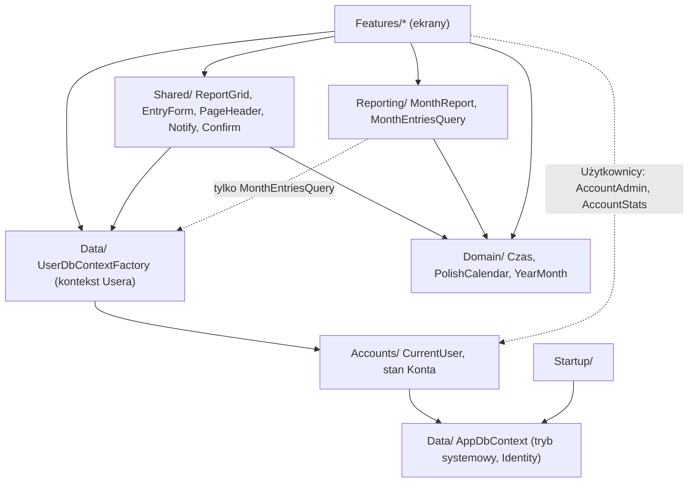
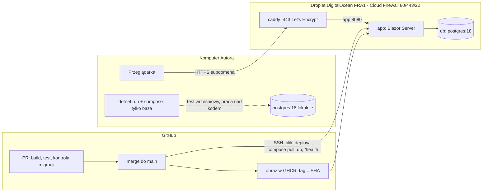
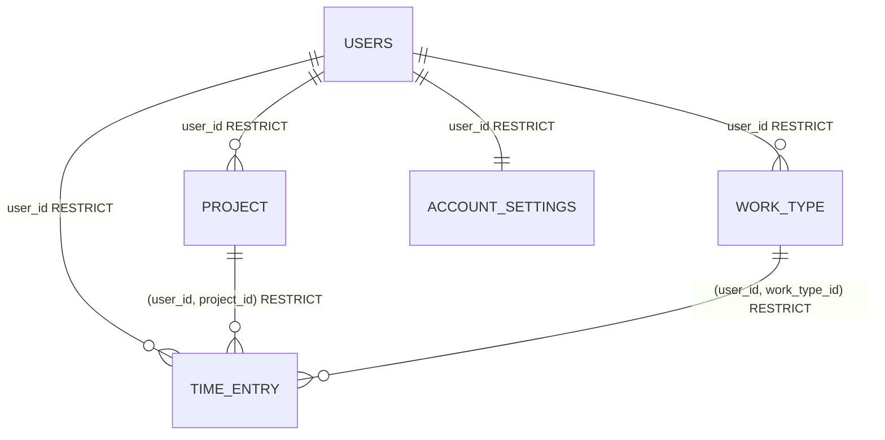

# Architecture Spine — Rejestr czasu pracy

## Design Paradigm

**Transaction Script w komponentach Blazor z czystym rdzeniem raportowym, dane oddzielone per User.** Każdy ekran (komponent Blazor Interactive Server) sam czyta i zapisuje dane przez EF Core; nie ma warstw Application/Infrastructure ani repozytoriów. Każdy kontekst bazy ekranu jest związany z zalogowanym Userem (AD-16), więc ekran nigdy nie filtruje po Userze sam. Wyjątki są nazwane: liczenie sum i Wierszy zestawienia (`Reporting/`), formatowanie Czasu i kalendarza (`Domain/`), Konta (`Accounts/`) i kilka wspólnych elementów (`Shared/`), których ekrany nie piszą same. Kod z historii 1.1 przechodzi do tego układu: `Components/App.razor`, `Routes.razor`, `Pages/Error` i `Pages/NotFound` zostają w `Components/`, `Components/Layout/MainLayout` przechodzi do `Shared/`, `Options/` i `SecurityHeaders.cs` zostają, `BackupOptions` i `ExportOptions` są usuwane.

| Obszar | Katalog | Zawiera |
| --- | --- | --- |
| Ekrany | `Features/<Funkcja>/` | komponenty `.razor`, walidatory, zapytania EF Core |
| Konta | `Accounts/` | statyczne strony `/konto/...`, `AccountLayout`, `CurrentUser`, walidacja ciasteczka, `AccountAdmin`, `AccountStats`, `DeleteAccount` |
| Rdzeń raportowy | `Reporting/` | `MonthReport`, `MonthEntriesQuery` |
| Typy domeny | `Domain/` | `Czas`, `PolishCalendar`, `YearMonth` (bez EF i UI) |
| Dane | `Data/` | `AppDbContext`, `IUserOwned`, `UserDbContextFactory`, encje, migracje, `DbErrors`, `DictionaryOptions` |
| Start | `Startup/` | sprawdzenie bazy, migracje, pierwszy Administrator |
| Pomoc | `Features/Pomoc/` | `HelpTopics`, trasa `/pomoc/{temat}`, treści tematów |
| Wspólne UI | `Shared/` | `ReportGrid<T>`, `EntryForm`, `MainLayout`, `PageHeader`, `DownloadLink`, `Notify`, `Confirm`, `EntryDateMemory` |
| Eksport | `Features/Zestawienie/` | endpoint `GET /zestawienie/{rok}/{miesiac}`, ClosedXML |



Strzałka = „może zależeć od”. `MonthReport` i `Domain/` nie zależą od EF Core ani UI. Tylko `Accounts/`, `Startup/`, Identity, Data Protection i `/health` używają `AppDbContext` w trybie systemowym (AD-16).

## Invariants & Rules

### AD-1 — Stos .NET + Blazor + PostgreSQL [ADOPTED]

- **Binds:** all
- **Prevents:** mieszaniu stosów i bibliotek UI między epikami.
- **Rule:** .NET 10, Blazor Web App z Interactive Server dla stron aplikacji (scaffold z historii 1.1), Microsoft Fluent UI Blazor 5.x jako jedyna biblioteka komponentów, FluentValidation 12 przez Blazilla, EF Core 10 z Npgsql i `UseSnakeCaseNamingConvention()`, ASP.NET Core Identity na EF Core, PostgreSQL 18. Bez innych bibliotek UI i bez własnego JavaScriptu. Wersja SDK przypięta w `global.json` na najnowszą poprawkę 10.0.4xx z runtime co najmniej 10.0.14.

### AD-2 — PostgreSQL w Dockerze, lokalnie i na serwerze [ADOPTED]

- **Binds:** R15, NFR-4, NFR-8
- **Prevents:** wystawieniu bazy do internetu i różnym sposobom uruchamiania bazy.
- **Rule:** obraz `postgres:18` (nigdy `latest`), nazwany wolumen na `/var/lib/postgresql`, hasło z `.env` poza gitem. Lokalnie (praca nad kodem, Test wrześniowy): `docker-compose.yml` w katalogu głównym uruchamia tylko bazę na `127.0.0.1:${POSTGRES_PORT}`; Autor uruchamia `docker compose up -d`, potem `dotnet run` na porcie z `launchSettings.json` (nie z `appsettings.json`, który nie ma klucza `Urls`). Na serwerze: `deploy/compose.yml` (AD-19); wolumen bazy na dysku Dropletu (nie Block Storage, którego kopie Dropletu nie obejmują), port publikowany tylko na `127.0.0.1` Dropletu dla tunelu SSH. Aplikacja łączy się użytkownikiem bazy z `POSTGRES_USER` (właściciel schematu); rola tylko do odczytu `rejestr_ro` dla Administratora powstaje raz ręcznie według `docs/admin/`.

### AD-3 — Kolejność startu i Kopia bazy — wycofane 31.10.2026

- **Binds:** —
- **Prevents:** —
- **Rule:** wycofane (R14 wycofane). Kolejność startu jest w AD-21; kopie zapewniają kopie Dropletu (AD-19); aplikacja nie zawiera kodu kopii.

### AD-4 — Krótko żyjący kontekst na operację [ADOPTED]

- **Binds:** all ekrany, R21, R23
- **Prevents:** wyjątkom współbieżności, nieaktualnym danym w obwodzie Interactive Server i kontekstom bez Usera.
- **Rule:** ekrany danych wstrzykują `Data/UserDbContextFactory` (AD-16) i tworzą kontekst na jedną operację (`await using`), materializując wynik (`ToListAsync`) przed jego zwolnieniem. Operacje na Kontach w obwodzie (`Accounts/AccountAdmin`, `DeleteAccount`) tworzą na każdą operację nowy scope (`IServiceScopeFactory.CreateAsyncScope()`) i biorą z niego `UserManager` i `AppDbContext`. Zakaz wstrzykiwania do komponentu `AppDbContext`, `IDbContextFactory<AppDbContext>`, `UserManager` i `SignInManager`, przekazywania `IQueryable` poza operację i trzymania encji śledzonych między operacjami. Po każdej zmianie ekran ponownie wczytuje dane z bazy.

### AD-5 — Jedno źródło sum

- **Binds:** R9, R10, R11, R12
- **Prevents:** dwóm implementacjom Sum i złączania, które łamią R10.
- **Rule:** Wpisy Miesiąca zalogowanego Usera ładuje wyłącznie `Reporting/MonthEntriesQuery.LoadAsync(YearMonth)`. Sumę dnia, Sumę tygodnia (tylko dni danego Miesiąca), sumę Miesiąca, Wiersze zestawienia (złączanie, opisy w kolejności rosnącego `Id`) i kolejność dni oraz wierszy liczy wyłącznie czysty `MonthReport.Build(YearMonth, IReadOnlyList<MonthEntry>)`. Jego typy wejścia i wyjścia (`MonthEntry`, dni z Wpisami, Wiersze zestawienia, tygodnie, suma Miesiąca) powstają w całości w jednej historii, zanim użyje ich Widok miesiąca lub eksport. Żaden ekran ani zapytanie nie sumuje Czasu na własną rękę; jedyny wyjątek to suma pod Listą wpisów (R8), liczona z tej samej materializowanej listy co wiersze.

### AD-6 — Czas, daty, kultura, strefa

- **Binds:** R4, R5, R7, R9, R11, R12, R16, R21, NFR-4, NFR-5, NFR-7
- **Prevents:** mieszaniu minut, godzin dziesiętnych i tekstu; tygodniom od niedzieli; angielskim tekstom; dacie „dzisiaj” według zegara serwera w UTC.
- **Rule:** Czas przechowywany i liczony jako `int` minut. Jedyne miejsca konwersji: `Domain/Czas` (parsowanie i formatowanie `h:mm`, także sum powyżej 24 h, np. `30:00`; godziny dziesiętne dla eksportu) i `Domain/PolishCalendar` (nazwy dni i miesięcy w mianowniku, początek tygodnia w poniedziałek). Miesiąc to `Domain/YearMonth`. Data Wpisu to `DateOnly`. „Dzisiaj” daje wyłącznie `PolishCalendar.Today`: czas z `TimeProvider` przeliczony na strefę `Europe/Warsaw`; zakaz `DateTime.Today`, `DateTime.Now` i `DateOnly.FromDateTime(DateTime.Now)`. Znaczniki czasu (rejestracja, ostatnie logowanie) zapisywane w UTC (`timestamptz`), wyświetlane w czasie polskim przez `PolishCalendar`. Kultura `pl-PL`. Wszystkie teksty dla Usera po polsku: teksty Fluent UI przez własny `IFluentLocalizer`, błędy Identity przez polski `IdentityErrorDescriber`, odpowiedź limitera prób po polsku. Obraz kontenera z ICU i tzdata (AD-20).

### AD-7 — Schemat i integralność danych

- **Binds:** R1, R2, R3, R18, R21, R24, R25, NFR-9
- **Prevents:** dwóm właścicielom encji, konfliktom migracji, dwóm sposobom wykrywania duplikatów i Wpisowi wskazującemu cudzy Słownik.
- **Rule:** epic-konta-i-wdrozenie przepisuje migrację `Initial` (stara usunięta, lokalny wolumen zakładany od nowa) i tworzy w niej cały schemat: tabele Identity z kluczami `int` i nazwami `snake_case` nadanymi jawnie (`users`, `roles`, `user_roles`, `user_claims`, `user_logins`, `user_tokens`, `role_claims`), użytkownika z kolumnami `status` (`pending` | `active` | `blocked`), `registered_at`, `last_login_at` i `must_change_password`, tabelę `account_settings` (`user_id`, prefiks Zestawienia), tabelę `data_protection_keys`, oraz `Project` (`user_id`, kod, nazwa, `is_active`), `WorkType` (`user_id`, nazwa, `is_active`), `TimeEntry` (`user_id`, data, Projekt, Typ pracy, opis, minuty). `user_id` jest wymagany w trzech tabelach danych i w `account_settings`. Kod Projektu normalizowany do wielkich liter w `SaveChanges`, unikalny indeks `(user_id, code)`; nazwa Typu pracy unikalna przez indeks funkcyjny `(user_id, lower(name))` dodany SQL-em w `Initial`. Wpis wskazuje Słownik złożonymi kluczami obcymi `(user_id, project_id)` i `(user_id, work_type_id)` (klucze alternatywne `(user_id, id)` w Słownikach), z `ON DELETE RESTRICT`; każda tabela z `user_id` ma klucz obcy do `users` z `ON DELETE RESTRICT`. Naruszenie unikalności rozpoznaje wyłącznie `Data/DbErrors`; ekran pokazuje je w `MessageBar`. Liczbę Wpisów do komunikatu R3 daje zapytanie przed próbą usunięcia. Wiersz `account_settings` powstaje leniwie, przy pierwszym zapisie Ustawień konta w kontekście Usera; brak wiersza oznacza pusty prefiks. Rejestracja i pierwszy Administrator go nie tworzą, bo tryb systemowy nie zapisuje encji `IUserOwned` (AD-16). Kolejne epiki zmieniają schemat tylko nową migracją według AD-21.

### AD-8 — Walidacja formularzy

- **Binds:** R1, R4, R5, R7, R16, R18, R22, R25
- **Prevents:** powielaniu reguł Czasu, pól wymaganych i reguł hasła.
- **Rule:** jeden walidator FluentValidation na formularz interaktywny (Wpis, Projekt, Typ pracy, prefiks w Ustawieniach konta), podpięty przez Blazilla; ekran nie zapisuje modelu, który nie przeszedł walidatora. Walidator sprawdza format i pola wymagane, nie unikalność (AD-7). Reguły Czasu walidator bierze z `Domain/Czas`. Reguły loginu i hasła ustala wyłącznie konfiguracja Identity (AD-15); statyczne formularze `/konto/...` pokazują błędy `IdentityResult` po polsku (AD-6).

### AD-9 — Jedna siatka raportów

- **Binds:** R2, R8, R9, R17, R21
- **Prevents:** osobnej siatce w każdym epiku i sumom liczonym z przefiltrowanych wierszy.
- **Rule:** każdy raport, lista Słownika i lista Kont na ekranie Użytkownicy używa `Shared/ReportGrid<T>` (nakładka na `FluentDataGrid`). Siatka przyjmuje `IReadOnlyList<T>` (nigdy `IQueryable`), zachowuje kolejność wejścia i sama nie liczy sum. Zakres v1: filtr wartości w każdej kolumnie, licznik pozycji, ikony akcji w wierszu jako lista akcji zadana przez ekran (ikona, etykieta, warunek widoczności, wywołanie), stałe grupowanie zadane przez ekran z sumą podaną przez ekran. Filtr tylko ukrywa wiersze; sumy w nagłówkach grup Widoku miesiąca (Tydzień → Dzień) pochodzą z `MonthReport` dla całego Miesiąca. Bez eksportu CSV.

### AD-10 — Formularz Wpisu w dwóch hostach [ADOPTED]

- **Binds:** R4, R5, R6, R7, R16
- **Prevents:** dwóm formularzom Wpisu i dwóm ścieżkom kopii i usuwania.
- **Rule:** jeden komponent `Shared/EntryForm` hostowany (a) na stronie `/wpisy/nowy` (przycisk Nowy wpis, Sesja wpisywania: przy każdym otwarciu strony data to `PolishCalendar.Today`, po zapisie formularz zostaje z tą samą datą, R5) i (b) w oknie dialogowym otwieranym z ikon edycji i kopii w wierszu raportu (po zapisie okno się zamyka, raport wczytuje dane ponownie). Datę ostatnio ustawioną na `/wpisy/nowy` pamięta `Shared/EntryDateMemory` (w pamięci serwera według `UserId`, do wylogowania lub restartu aplikacji); kopia bierze ją, a bez niej `PolishCalendar.Today` (R7). Usunięcie Wpisu tylko przez jedną operację `DeleteEntry` po potwierdzeniu przez `Shared/Confirm`. Klawiatura: kolejność fokusu data → Projekt → Typ pracy → opis → Czas, zapis klawiszem Enter, bez okna potwierdzenia przy zapisie. Opcje list Projektu i Typu pracy daje wyłącznie `Data/DictionaryOptions` (aktywne pozycje zalogowanego Usera plus bieżąca wartość edytowanego Wpisu; przy kopii bez bieżącej wartości, R7; sortowanie `pl-PL`); Widok, Lista i eksport nigdy nie filtrują po aktywności.

### AD-11 — Komunikaty i układ

- **Binds:** all ekrany, R19, R26, R31, NFR-6
- **Prevents:** różnym wzorcom potwierdzeń, błędów, nagłówków i nawigacji między epikami.
- **Rule:** walidacja i mniej istotne operacje → `FluentMessageBar` przez `Shared/Notify`; każde potwierdzenie (usunięcie Wpisu, pozycji Słownika, akcje Konta) → `Shared/Confirm` na `IDialogService.ShowMessageBoxAsync` bez skrótu klawiszowego przycisku głównego (Enter i „Y” nie zatwierdzają), fokus na Anuluj; bez toastów. `Shared/MainLayout`: belka górna z ikoną Pomoc `?` (AD-22), linkiem Ustawienia konta i przyciskiem Wyloguj (formularz POST z antyforgery do `/konto/wyloguj`, AD-15); menu boczne: przycisk Nowy wpis; Rejestr (Widok miesiąca, Lista wpisów, Eksport); Słowniki (Projekty, Typy pracy); Administracja (Użytkownicy) renderowana tylko dla roli Administrator. Każdy ekran ustawia nagłówek wyłącznie przez `Shared/PageHeader` (tytuł, podtytuł, okruszki, wywołanie Odśwież, klucz tematu pomocy), a `MainLayout` bierze z niego temat dla `?`. Pozycje i linki do ekranów jeszcze niezbudowanych prowadzą do polskiej strony „nie znaleziono”. Zerwane połączenie: własny znacznik `components-reconnect-modal` z polskim tekstem i CSS, z linkiem „Odśwież stronę”, bez JS i bez przycisku ponowienia (R31). Skala 90/100/110/125% według szerokości okna; motyw jasny/ciemny. Statyczne strony `/konto/...` używają `Accounts/AccountLayout`: bez menu, z linkiem Pomoc do tematu strony.

### AD-12 — Zero połączeń wychodzących aplikacji [ADOPTED]

- **Binds:** NFR-1
- **Prevents:** CDN-om, zewnętrznym czcionkom i skryptom dodanym „przy okazji”.
- **Rule:** zasoby tylko z aplikacji (Fluent UI z `_content`), czcionka systemowa Segoe UI, nagłówek `Content-Security-Policy` z `script-src 'self'` na każdej odpowiedzi, także stron `/konto/...`. Zakaz komponentów Fluent UI, które ładują skrypty z unpkg: `FluentNumberInput`, pól z `MaskPattern`, `FluentSortableList`. Passkeys z szablonu Identity usunięte (bez ich ekranów i JS). Ruch z przeglądarki wyłącznie przez HTTPS od Caddy (AD-19). Telemetria CLI wyłączona zmienną `DOTNET_CLI_TELEMETRY_OPTOUT=1` (README, potok).

### AD-13 — Konfiguracja, sekrety i prywatność repozytorium

- **Binds:** R13, R15, R20, R25, NFR-2
- **Prevents:** danym osobistym i hasłom w gicie, obrazie i logach potoku oraz rozjazdowi nazw zmiennych między compose, aplikacją i potokiem.
- **Rule:** `appsettings.json` w repozytorium ma tylko bezpieczne wartości domyślne. Lokalnie: `appsettings.Local.json` i `.env` ładowane jawnie i wykluczone w `.gitignore`. Na serwerze: `/opt/rejestr-czasu/.env` z `chmod 600`, przekazany przez `env_file` w `deploy/compose.yml`. Kontrakt nazw w `.env` serwera: `SITE_DOMAIN`, `APP_IMAGE_TAG`, `POSTGRES_USER`, `POSTGRES_PASSWORD`, `POSTGRES_DB`, `Database__Host`, `Database__Name`, `Database__User`, `Database__Password`, `FirstAdmin__UserName`, `FirstAdmin__Password`; aplikacja w kontenerze nasłuchuje na `ASPNETCORE_HTTP_PORTS=8080`, a Caddy przekazuje do `app:8080`. Sekrety potoku (klucz SSH, host, użytkownik) tylko w GitHub Secrets; workflow nie wypisuje ich i nie kopiuje `.env`. Obraz nie zawiera `appsettings.Local.json`, `.env` ani danych. Prefiks Zestawienia jest danymi Usera w `account_settings`, nie konfiguracją. Sekcje konfiguracji czytane przez `IOptions<T>`. Dane testowe zanonimizowane; prawdziwe dane wrześniowe nigdy w repozytorium ani na serwerze.

### AD-14 — Zestawienie przez endpoint i ClosedXML

- **Binds:** R12, R13
- **Prevents:** pobieraniu pliku przez JavaScript, przechwyceniu linku przez router Blazora, dwóm ścieżkom eksportu, formułom w pliku i eksportowi cudzych Wpisów.
- **Rule:** plik zwraca endpoint Minimal API `GET /zestawienie/{rok}/{miesiac}` z `RequireAuthorization()`; dane ładuje `MonthEntriesQuery` w kontekście zalogowanego Usera (AD-16), prefiks nazwy z jego `account_settings` (brak wiersza = pusty prefiks), nazwę pliku z polskimi znakami ustawia `Results.File(..., fileDownloadName)`. Nieaktywne Konto dostaje to samo co anonim (przekierowanie na logowanie, AD-17). Ekran Eksport (wybór Miesiąca) i przycisk w Widoku miesiąca używają wyłącznie `Shared/DownloadLink` (link z atrybutem `download`, którego router nie przechwytuje); zakaz `NavigateTo` do endpointu. Ekran przed pokazaniem linku sprawdza, czy Miesiąc ma Wpisy, i pokazuje komunikat R13. Plik buduje ClosedXML z wyniku `MonthReport`, w układzie z `export-layout.md`; sumy jako wartości.

### AD-15 — Konta i logowanie przez Identity [ADOPTED]

- **Binds:** R18, R19, R20, R21, R22, R25, NFR-8
- **Prevents:** dwóm modelom stanu Konta, logowaniu i zmianie hasła przez obwód Blazora, ujawnianiu stanu Konta bez hasła i rozjazdowi reguł blokady.
- **Rule:** ASP.NET Core Identity (`IdentityUser<int>`, `IdentityRole<int>`, `IdentityDbContext` w `AppDbContext`), role `Administrator` i `User`; każde Konto ma rolę `User`, Konto Autora także `Administrator`. Login (`UserName`) unikalny bez względu na wielkość liter, bez e-maila; `IEmailSender` jako implementacja bez wysyłki. Stan Konta to wyłącznie kolumna `status` (AD-7): rejestracja tworzy `pending` z rolą `User` (bez wiersza `account_settings`, AD-7); logowanie najpierw sprawdza hasło, a dopiero przy poprawnym haśle pokazuje komunikat o stanie `pending` lub `blocked` (przy złym haśle zawsze „Nieprawidłowy login lub hasło”); dopuszcza tylko `active`. Po udanym logowaniu strona logowania zapisuje `last_login_at`. Lockout Identity służy tylko blokadzie po nieudanych próbach: `MaxFailedAccessAttempts = 5`, `DefaultLockoutTimeSpan = 15 min`, `PasswordSignInAsync(..., lockoutOnFailure: true)`; nigdy do blokowania przez Administratora. Hasło: minimum 6 znaków, bez wymogu cyfr i znaków specjalnych. Ciasteczko logowania: `LoginPath = /konto/logowanie`, `AccessDeniedPath = /konto/brak-dostepu`, ważne 14 dni z przedłużaniem przy aktywności. Strony logowania, rejestracji, wylogowania, brak dostępu i zmiany hasła są statyczne (SSR, `[ExcludeFromInteractiveRouting]`, a `App.razor` wybiera tryb przez `HttpContext.AcceptsInteractiveRouting()`) pod `/konto/...`, bo tylko odpowiedź HTTP ustawia ciasteczko; `/konto/wyloguj` przyjmuje tylko POST z antyforgery. Każda zmiana własnego hasła (wymuszona i dobrowolna z podaniem obecnego) odbywa się wyłącznie na `/konto/zmiana-hasla` i kończy się `RefreshSignInAsync`; Ustawienia konta tylko do niej linkują. Hasło ustawione przez Administratora ustawia `must_change_password`; middleware po uwierzytelnieniu przekierowuje wtedy każde żądanie strony lub endpointu na `/konto/zmiana-hasla`, poza endpointami rozpoznanymi po metadanych: zasoby `MapStaticAssets`, `/_framework`, `/_blazor`, `/health`, `/konto/zmiana-hasla`, `/konto/wyloguj` i anonimowe tematy pomocy. Rejestracja i logowanie mają limit 10 żądań POST na minutę na adres IP (`[EnableRateLimiting]`, limiter po `UseForwardedHeaders`). Każda zmiana hasła, stanu lub ról aktualizuje security stamp.

### AD-16 — Oddzielenie danych przez kontekst Usera [ADOPTED]

- **Binds:** R1, R3, R8, R9, R12, R23, R24
- **Prevents:** zapytaniom bez filtra, ekranom ustawiającym `UserId` ręcznie, dwóm sposobom ustalania bieżącego Usera i przeciekowi danych między Userami.
- **Rule:** każda encja z `user_id` implementuje `Data/IUserOwned`; globalny filtr i nadawanie `user_id` stosuje `AppDbContext` po tym interfejsie, nie po liście tabel. `AppDbContext` ma dwa tryby: **Usera** (z `UserId`: filtr `user_id = UserId`, `SaveChanges` nadaje `user_id` nowym rekordom `IUserOwned` i odrzuca zmianę `user_id`) i **systemowy** (bez `UserId`: filtr na `IUserOwned` daje pusty wynik, a zapis encji `IUserOwned` rzuca wyjątek). Tryb Usera daje wyłącznie `Data/UserDbContextFactory`, która bierze Usera z `Accounts/CurrentUser` i rzuca wyjątek, gdy nie ma zalogowanego, Aktywnego Usera. `CurrentUser` ma jedno źródło na host: w obwodzie `AuthenticationStateProvider`, w żądaniu HTTP (endpoint Zestawienia) `HttpContext.User`; `UserId` zawsze z claimu `NameIdentifier`; zakaz ustalania Usera po loginie. Tryb systemowy używają tylko Identity, Data Protection, `/health`, `Startup/` i `Accounts/`. `IgnoreQueryFilters()` wolno użyć wyłącznie w dwóch nazwanych miejscach: `Accounts/AccountStats` (liczba Wpisów na ekranie Użytkownicy) i `Accounts/DeleteAccount` (AD-18); każde ma test. Testy potoku (AD-20): każda encja z kolumną `user_id` jest `IUserOwned`, a test oddzielenia dla dwóch Userów obejmuje każdy ekran danych i endpoint Zestawienia.

### AD-17 — Stan Konta w trakcie sesji

- **Binds:** R19, R21, R22
- **Prevents:** zablokowanemu Userowi pracującemu dalej, dwóm mechanizmom reakcji na stan Konta i epikowi Administracji przerabiającemu logowanie.
- **Rule:** na każdym żądaniu HTTP `CookieAuthenticationEvents.OnValidatePrincipal` czyta `status`, `must_change_password` i security stamp; przy Koncie nieaktywnym lub niezgodnym stampie odrzuca tożsamość i kasuje ciasteczko. To jedyne miejsce, które kasuje ciasteczko poza `/konto/wyloguj`. W obwodzie `CurrentUser` przy każdym utworzeniu kontekstu przez `UserDbContextFactory` czyta `status` i `must_change_password` z bazy i przy niepowodzeniu rzuca `AccountInactiveException` lub `PasswordChangeRequiredException`; `Shared/MainLayout` łapie je i robi `NavigateTo` z `forceLoad` na `/konto/logowanie?powod=<stan>` lub `/konto/zmiana-hasla`, a walidator ciasteczka kończy sesję na tym żądaniu. `RevalidatingServerAuthenticationStateProvider` sprawdza co 1 minutę security stamp i `status`, żeby zamknąć bezczynne obwody. epic-administracja-kont-i-pomoc tylko zmienia `status`, hasło i security stamp przez `Accounts/AccountAdmin`; nie dotyka logowania ani `CurrentUser`.

### AD-18 — Usuwanie i odrzucanie Konta

- **Binds:** R21, R23
- **Prevents:** częściowo usuniętemu Kontu i dwóm ścieżkom usuwania.
- **Rule:** jedna operacja `Accounts/DeleteAccount` w nowym scope (AD-4), na jednym `AppDbContext` tego scope i jednej transakcji (`BeginTransactionAsync`), z której korzysta też `UserManager`: usuwa wszystkie encje `IUserOwned` Konta w kolejności zależności kluczy obcych wyliczonej z modelu (Wpisy przed Słownikami), potem Konto; wszystko albo nic, bez `ON DELETE CASCADE`. Dopuszczalna dla Konta `blocked` (po wpisaniu loginu) i `pending` (odrzucenie, zwykłe potwierdzenie). Administrator nie może zmienić stanu, odrzucić ani usunąć własnego Konta; sprawdza to operacja, nie tylko UI. Test usuwania Konta obejmuje każdą encję `IUserOwned`.

### AD-19 — Serwer i jego otoczenie [ADOPTED]

- **Binds:** R15, R16, R20, R27, R29, NFR-1, NFR-4, NFR-8
- **Prevents:** różnym układom serwera między historiami i wystawieniu czegokolwiek poza HTTPS.
- **Rule:** jeden Droplet DigitalOcean w regionie Frankfurt (FRA1) z Dockerem i `deploy/compose.yml` z trzema usługami: `caddy` (`caddy:2.11`, porty 80 i 443, automatyczne HTTPS Let's Encrypt dla `SITE_DOMAIN`, wolumeny `/data` i `/config`, `reverse_proxy app:8080`), `app` (obraz `ghcr.io/<repo>:${APP_IMAGE_TAG}`, bez publikowanych portów), `db` (AD-2). Każda usługa ma rotację logów (`json-file`, ograniczony rozmiar). Cloud Firewall: tylko 80, 443 i 22; SSH tylko kluczem. Aplikacja za proxy: `UseForwardedHeaders` (`XForwardedFor`, `XForwardedProto`) jako pierwszy element potoku, z siecią compose w `KnownIPNetworks`. Klucze Data Protection w bazie (`PersistKeysToDbContext`) ze stałym `SetApplicationName`, więc wdrożenie nie wylogowuje. Dostęp Administratora do bazy: tunel SSH lub `docker exec psql`, na co dzień rolą `rejestr_ro`. Kopie: włączone kopie Dropletu; odtworzenie zawsze na nowy Droplet. Jedna instancja aplikacji.

### AD-20 — CI/CD i rollback [ADOPTED]

- **Binds:** R24, R28, R29, R30, NFR-2, NFR-9
- **Prevents:** wdrożeniom poza potokiem, niesprawdzonym zmianom na `main`, rozjazdowi plików serwera i rollbackowi na niezgodnym schemacie.
- **Rule:** GitHub Actions. Workflow PR: `dotnet build`, `dotnet test` (z Testcontainers na `ubuntu-latest`), `dotnet ef migrations has-pending-model-changes` i kontrola migracji (AD-21); ochrona `main` wymaga ich przejścia i aktualności gałęzi względem `main`. Workflow po merge do `main`: obraz z `mcr.microsoft.com/dotnet/aspnet:10.0` (wariant z ICU i tzdata, nie chiseled) do publicznego GHCR z tagiem pełnego skrótu commita (logowanie `GITHUB_TOKEN`, `packages: write`); potem kopiuje na Droplet `deploy/compose.yml` i `deploy/Caddyfile` z tego commita, ustawia `APP_IMAGE_TAG` w `.env`, uruchamia `docker compose pull && docker compose up -d` i czeka do 60 s na `GET /health` (sprawdza też bazę); błąd kończy workflow bez automatycznego powrotu. Rollback: ten sam krok wdrożenia uruchamiany ręcznie (`workflow_dispatch`) z tagiem wcześniejszego obrazu, z plikami `deploy/` z commita tego tagu. Jedyne ręczne kroki na serwerze i w GitHubie (przygotowanie Dropletu, `.env`, rola `rejestr_ro`, jednorazowe przełączenie pakietu GHCR na publiczny) opisuje `docs/admin/`.

### AD-21 — Start i migracje

- **Binds:** R20, R29, R30, NFR-9
- **Prevents:** migracji niszczącej dane, rollbackowi, który nie działa na nowszym schemacie, konfliktom migracji z równoległych epików i dwóm ścieżkom tworzenia Administratora.
- **Rule:** przed przyjęciem pierwszego żądania, w tej kolejności: (1) sprawdzenie połączenia z bazą, (2) `Database.Migrate()`, (3) pierwszy Administrator: gdy w bazie nie ma żadnego Konta z rolą Administrator, powstaje Konto `active` z rolami `Administrator` i `User` (bez wiersza `account_settings`, AD-7), z `FirstAdmin__UserName` i `FirstAdmin__Password`; gdy istnieje, konfiguracja jest ignorowana, (4) start serwera. Błąd kroków 1–3 kończy proces z czytelnym komunikatem. `Initial` z całym schematem AD-7 zamraża historia epic-konta-i-wdrozenie, która jako pierwsza wdraża na serwer. Od niej migracje tylko dodają (tabele, kolumny dopuszczające `NULL` lub z wartością domyślną, indeksy nieunikalne; indeks unikalny, klucz i klucz obcy tylko na tabeli tworzonej w tej samej migracji, bo poprzedni obraz jej nie zna); kontrola w potoku pomija `Initial` i działa jako lista dozwolonych operacji: każda inna, w tym usuwanie lub zmiana nazwy tabeli, kolumny, indeksu albo klucza, zmiana kolumny, nowy indeks unikalny na istniejącej tabeli i `migrationBuilder.Sql(...)`, odrzuca migrację. Konflikt migracji z dwóch gałęzi rozwiązuje się usunięciem migracji gałęzi i wygenerowaniem jej od nowa na aktualnym `main`. Dzięki temu poprzedni obraz działa na nowszym schemacie i rollback nie cofa bazy.

### AD-22 — Strony pomocy

- **Binds:** R26
- **Prevents:** różnym sposobom pisania, łączenia i chronienia pomocy w każdym epiku.
- **Rule:** jedna trasa `/pomoc/{temat}` w `Features/Pomoc/`, oznaczona `[AllowAnonymous]`; o dostępie decyduje sam komponent według `HelpTopics` (klucz, tytuł, komponent treści, dostęp: Anonim, Zalogowany lub Administrator), a brak dostępu daje ten sam widok co `/konto/brak-dostepu`. `HelpTopics` to jedyna lista tematów; spis `/pomoc` generuje się z niej; zakaz osobnych `@page "/pomoc/..."`. Klucz tematu to segment trasy ekranu w kebab-case (`projekty`, `typy-pracy`, `wpisy-nowy`, `wpisy`, `miesiac`, `eksport`, `ustawienia-konta`, `uzytkownicy`, `logowanie`, `rejestracja`, `zmiana-hasla`, `administracja`). Treść tematu to komponent Razor bez Markdowna i bibliotek. Ekran deklaruje temat w `Shared/PageHeader` (AD-11), strona `/konto/...` w `AccountLayout`. Tematy anonimowe renderują się w `AccountLayout`, pozostałe w `MainLayout`. Historia zmieniająca ekran aktualizuje jego temat w tej samej zmianie.

## Consistency Conventions

| Concern | Convention |
| --- | --- |
| Nazewnictwo | kod po angielsku (`Project`, `WorkType`, `TimeEntry`, `MonthReport`, `CurrentUser`); UI po polsku według `glossary.md` |
| Tabele i kolumny | `snake_case` przez `EFCore.NamingConventions`, tabele Identity nazwane jawnie (AD-7); klucze `id` typu `int`; znaczniki czasu `timestamptz` w UTC |
| Trasy | `/miesiac/{rok}/{miesiac}`, `/wpisy`, `/wpisy/nowy`, `/eksport`, `/projekty`, `/typy-pracy`, `/ustawienia-konta`, `/uzytkownicy`, `/pomoc/{temat}`, `/konto/logowanie`, `/konto/rejestracja`, `/konto/wyloguj`, `/konto/zmiana-hasla`, `/konto/brak-dostepu`, `/zestawienie/{rok}/{miesiac}`, `/health` |
| Autoryzacja | jeden mechanizm: `[Authorize]` w głównym `_Imports.razor` stron i `RequireAuthorization()` na każdym endpoincie poza `/health`; bez `FallbackPolicy`. `[AllowAnonymous]` tylko `/konto/logowanie`, `/konto/rejestracja`, `/konto/brak-dostepu`, `/pomoc/{temat}` (dostęp per temat, AD-22), strona „nie znaleziono” (`/not-found`) i `/Error` oraz `/health`. `/uzytkownicy` z rolą Administrator. `<NotAuthorized>` w `Routes`: anonim → przekierowanie z `forceLoad` na logowanie z `ReturnUrl`; zalogowany bez roli → widok brak dostępu |
| Błędy | nieobsłużony wyjątek w ekranie → `Notify` z ogólnym komunikatem i wpis w logu; wyjątki stanu Konta obsługuje `MainLayout` (AD-17) |
| Logi | domyślny `ILogger` .NET do konsoli (na serwerze `docker compose logs`, rotacja AD-19); bez haseł i treści Wpisów |
| Testy | `MonthReport` i `Czas` w xUnit bez bazy; ekrany w bUnit; zapis do bazy przez Testcontainers (`postgres:18`, schemat przez `Migrate()`, nie `EnsureCreated()`); testy oddzielenia danych i usuwania Konta dla dwóch Userów (AD-16, AD-18) |

## Stack

| Name | Version |
| --- | --- |
| .NET (LTS), Blazor Web App | 10 |
| .NET SDK | 10.0.403 (runtime 10.0.14; przypięty w `global.json`) |
| Microsoft.AspNetCore.Identity.EntityFrameworkCore | 10.0.14 |
| Microsoft.AspNetCore.DataProtection.EntityFrameworkCore | 10.0.14 |
| Microsoft.Extensions.Diagnostics.HealthChecks.EntityFrameworkCore | 10.0.14 |
| Microsoft.FluentUI.AspNetCore.Components | 5.0.1 |
| FluentValidation | 12.2.0 |
| Blazilla | 2.4.2 |
| Npgsql.EntityFrameworkCore.PostgreSQL | 10.0.3 |
| EFCore.NamingConventions | 10.0.1 |
| ClosedXML | 0.105.1 |
| xunit.v3 | 4.0.2 |
| bUnit | 2.13.3 |
| Testcontainers.PostgreSql | 4.16.0 |
| PostgreSQL (obraz Docker) | 18 (18.6) |
| Caddy (obraz Docker) | 2.11 (2.11.7) |
| Obraz aplikacji | mcr.microsoft.com/dotnet/aspnet:10.0 (Ubuntu 24.04, ICU i tzdata) |
| GitHub Actions | actions/checkout v7, actions/setup-dotnet v6, docker/login-action v4, docker/setup-buildx-action v4, docker/build-push-action v7, appleboy/ssh-action v1.2.5 |
| Docker Desktop (Windows, lokalnie) | zainstalowany |

## Structural Seed





```text
RejestrCzasu.sln
global.json                  # SDK 10.0.403
docker-compose.yml           # lokalnie: tylko postgres:18 na 127.0.0.1
.env                         # poza gitem
Dockerfile
deploy/compose.yml           # serwer: caddy, app, db
deploy/Caddyfile
.github/workflows/           # pr.yml, deploy.yml (merge i rollback)
docs/admin/                  # instrukcja administratora (Markdown)
src/RejestrCzasu/
  Components/                # App.razor, Routes.razor, Pages/Error, Pages/NotFound
  Accounts/                  # strony /konto, AccountLayout, CurrentUser, AccountAdmin, AccountStats, DeleteAccount
  Domain/                    # Czas, PolishCalendar, YearMonth
  Data/                      # AppDbContext, IUserOwned, UserDbContextFactory, encje, migracje, DbErrors, DictionaryOptions
  Reporting/                 # MonthReport, MonthEntriesQuery
  Features/                  # Wpisy, Miesiac, ListaWpisow, Zestawienie, Projekty, TypyPracy, UstawieniaKonta, Uzytkownicy, Pomoc
  Shared/                    # ReportGrid<T>, EntryForm, MainLayout, PageHeader, DownloadLink, Notify, Confirm, EntryDateMemory
  Options/                   # DatabaseOptions, FirstAdminOptions
  Startup/                   # sprawdzenie bazy, migracje, pierwszy Administrator
  SecurityHeaders.cs         # CSP
tests/RejestrCzasu.Tests/
```

## Capability → Architecture Map

| Capability / Area | Lives in | Governed by |
| --- | --- | --- |
| R1–R3 Słowniki | `Features/Projekty`, `Features/TypyPracy` | AD-4, AD-7, AD-8, AD-9, AD-11, AD-16 |
| R4–R7, R16 Wpisy i Sesja wpisywania | `Shared/EntryForm`, `Features/Wpisy` | AD-6, AD-8, AD-10, AD-16 |
| R8 Lista wpisów | `Features/ListaWpisow` | AD-4, AD-9, AD-10, AD-16 |
| R9–R10 Widok miesiąca | `Features/Miesiac`, `Reporting/` | AD-5, AD-6, AD-9, AD-16 |
| R11–R13 Zestawienie | `Features/Zestawienie`, `Reporting/` | AD-5, AD-6, AD-13, AD-14 |
| R15 Konfiguracja | `appsettings*.json`, `.env`, `deploy/` | AD-2, AD-13, AD-19 |
| R17 Filtry w siatce | `Shared/ReportGrid` | AD-9 |
| R18–R20 Rejestracja, logowanie, pierwszy Administrator | `Accounts/`, `Startup/` | AD-7, AD-15, AD-17, AD-21 |
| R21–R23 Użytkownicy, hasło, usuwanie | `Features/Uzytkownicy`, `Accounts/` | AD-4, AD-15, AD-17, AD-18 |
| R24 Oddzielenie danych | `Data/`, `Accounts/CurrentUser` | AD-7, AD-16, AD-20 |
| R25 Ustawienia konta | `Features/UstawieniaKonta`, `/konto/zmiana-hasla` | AD-8, AD-13, AD-15 |
| R26 Pomoc | `Features/Pomoc`, `Shared/PageHeader` | AD-11, AD-22 |
| R27 Instrukcja administratora | `docs/admin/` | AD-19, AD-20 |
| R28–R30 CI, wdrożenie, rollback | `.github/workflows/`, `deploy/`, `Dockerfile` | AD-20, AD-21 |
| R31 Zerwane połączenie | `Shared/MainLayout` | AD-11 |
| NFR-1 bez połączeń wychodzących | całość | AD-12, AD-19 |

## Deferred

- **Grupowanie sterowane przez użytkownika, sortowanie wielokolumnowe, wybór kolumn, edycja inline w `ReportGrid`** — odłożone przez Autora; v1 to filtr wartości, stałe grupowanie i ikony akcji.
- **Wygląd poszczególnych ekranów** (kolumny, rozmieszczenie pól, treść stron pomocy) — decyduje historia; spinają je AD-9, AD-10, AD-11, AD-22.
- **Szczegóły Testcontainers** (współdzielony kontener, czyszczenie danych) — ustalone w historii 1.1; nowe testy idą tym wzorcem.
- **Rozmiar Dropletu i częstotliwość kopii (tygodniowe czy dzienne)** — decyzja Autora przy zakładaniu serwera, zapisana w `docs/admin/`; architektura wymaga tylko włączonych kopii i bazy na dysku Dropletu.
- **Ćwiczenie odtworzenia z Kopii serwera** — na tymczasowym Droplecie w epic-administracja-kont-i-pomoc, procedura w `docs/admin/`.
- **Monitoring i powiadomienia o awarii** — poza zakresem v1; stan sprawdza `/health` po wdrożeniu.
