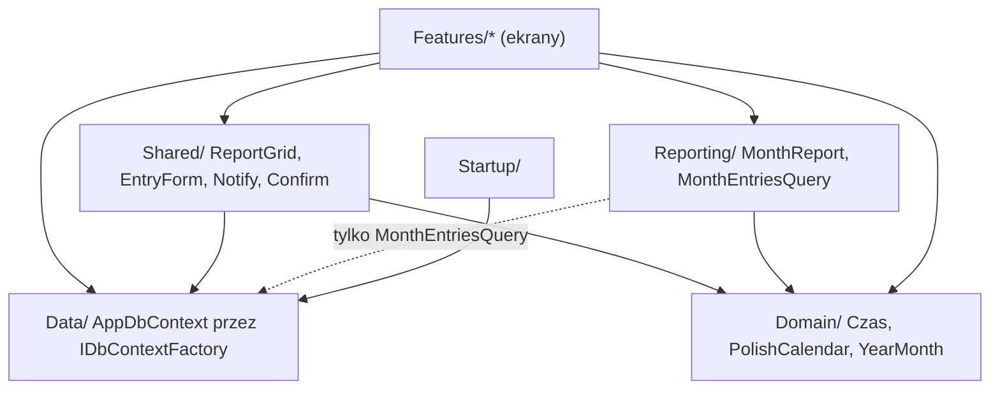
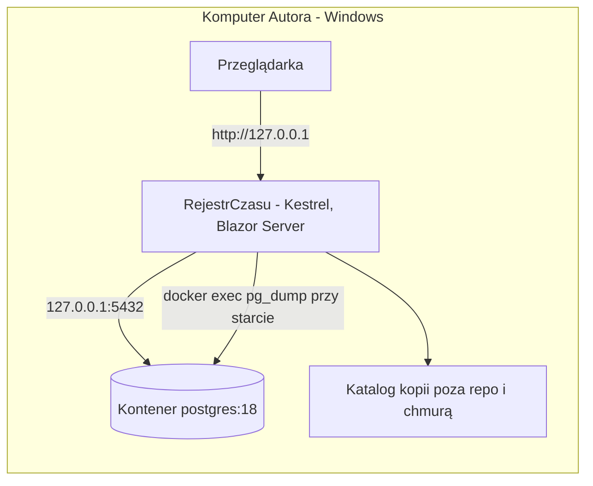
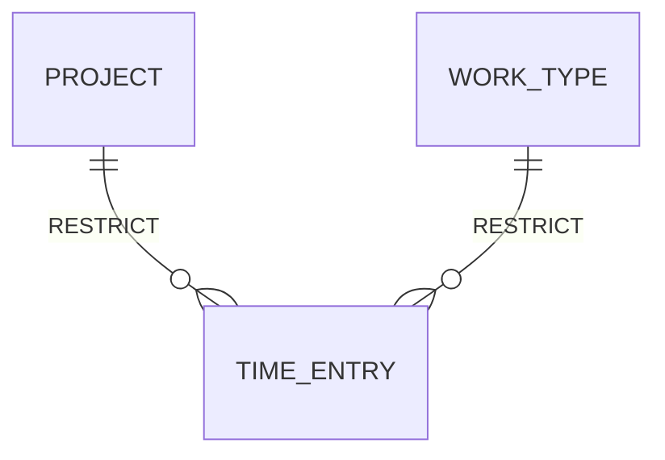

# Architecture Spine — Rejestr czasu pracy

## Design Paradigm

**Transaction Script w komponentach Blazor z czystym rdzeniem raportowym.** Każdy ekran (komponent Blazor Interactive Server) sam czyta i zapisuje dane przez EF Core; nie ma warstw Application/Infrastructure ani repozytoriów. Wyjątki są nazwane: liczenie sum i Wierszy zestawienia (`Reporting/`), formatowanie Czasu i kalendarza (`Domain/`) oraz kilka wspólnych elementów (`Shared/`), których ekrany nie piszą same.

| Obszar | Katalog | Zawiera |
| --- | --- | --- |
| Ekrany | `Features/<Funkcja>/` | komponenty `.razor`, walidatory, zapytania EF Core |
| Rdzeń raportowy | `Reporting/` | `MonthReport`, `MonthEntriesQuery` |
| Typy domeny | `Domain/` | `Czas`, `PolishCalendar`, `YearMonth` (bez EF i UI) |
| Dane | `Data/` | `AppDbContext`, encje, migracje, `DbErrors`, `DictionaryOptions` |
| Start | `Startup/` | sprawdzenie bazy, Kopia bazy, migracje |
| Wspólne UI | `Shared/` | `ReportGrid<T>`, `EntryForm`, `MainLayout`, `Notify`, `Confirm` |
| Eksport | `Features/Zestawienie/` | endpoint `GET /zestawienie/{rok}/{miesiac}`, ClosedXML |



Strzałka = „może zależeć od”. `MonthReport` i `Domain/` nie zależą od EF Core ani UI.

## Invariants & Rules

### AD-1 — Stos .NET + Blazor + PostgreSQL [ADOPTED]

- **Binds:** all
- **Prevents:** mieszaniu stosów i bibliotek UI między epikami.
- **Rule:** .NET 10, Blazor Web App z Interactive Server globalnie (scaffold: `dotnet new blazor --interactivity Server --all-interactive --empty --no-https`), Microsoft Fluent UI Blazor 5.x jako jedyna biblioteka komponentów, FluentValidation 12 przez Blazilla, EF Core 10 z Npgsql i `UseSnakeCaseNamingConvention()`, PostgreSQL 18. Bez innych bibliotek UI i bez własnego JavaScriptu.

### AD-2 — PostgreSQL w Dockerze, tylko lokalnie [ADOPTED]

- **Binds:** R14, R15, NFR-1
- **Prevents:** wystawieniu bazy w sieci i różnym sposobom uruchamiania bazy.
- **Rule:** `docker-compose.yml` w repozytorium: obraz `postgres:18` (nigdy `latest`), stały `container_name`, port `127.0.0.1:5432:5432`, nazwany wolumen na `/var/lib/postgresql`, `restart: "no"`, hasło z pliku `.env` wykluczonego w `.gitignore`. Kestrel nasłuchuje tylko na `http://127.0.0.1:<port>`. Autor uruchamia `docker compose up -d`, potem `dotnet run`.

### AD-3 — Kolejność startu i Kopia bazy

- **Binds:** R14, R15
- **Prevents:** migracji bez kopii i różnym ścieżkom błędu przy starcie.
- **Rule:** przed przyjęciem pierwszego żądania, w tej kolejności: (1) sprawdzenie połączenia z bazą, (2) Kopia bazy przez `docker exec <container_name> pg_dump` (bez `-t`, wyjście zapisywane binarnie) do katalogu kopii z konfiguracji, nazwa `rejestr-RRRR-MM-DD_GGMMSS.sql`, rotacja do 10 plików, najstarszy usuwany dopiero po udanym zapisie nowego, (3) `Database.Migrate()`, (4) start serwera. Błąd kroków 1–3 kończy proces z czytelnym komunikatem w konsoli (krok 1: „uruchom Docker Desktop i `docker compose up -d`”). W trakcie działania kopie nie powstają.

### AD-4 — Komponenty na bazie przez krótko żyjący kontekst [ADOPTED]

- **Binds:** all ekrany
- **Prevents:** wyjątkom współbieżności i nieaktualnym danym w obwodzie Interactive Server.
- **Rule:** ekrany wstrzykują `IDbContextFactory<AppDbContext>` i tworzą kontekst na jedną operację (`await using`), materializując wynik (`ToListAsync`) przed jego zwolnieniem. Zakaz wstrzykiwania `AppDbContext` do komponentu, przekazywania `IQueryable` poza operację i trzymania encji śledzonych między operacjami. Po każdej zmianie ekran ponownie wczytuje dane z bazy.

### AD-5 — Jedno źródło sum

- **Binds:** R9, R10, R11, R12
- **Prevents:** dwóm implementacjom Sum i złączania, które łamią R10.
- **Rule:** Wpisy Miesiąca ładuje wyłącznie `Reporting/MonthEntriesQuery.LoadAsync(YearMonth)`. Sumę dnia, Sumę tygodnia (tylko dni danego Miesiąca), sumę Miesiąca, Wiersze zestawienia (złączanie, opisy w kolejności rosnącego `Id`) i kolejność dni oraz wierszy liczy wyłącznie czysty `MonthReport.Build(YearMonth, IReadOnlyList<MonthEntry>)`. Jego typy wejścia i wyjścia (`MonthEntry`, dni z Wpisami, Wiersze zestawienia, tygodnie, suma Miesiąca) powstają w całości w jednej historii, zanim użyje ich Widok miesiąca lub eksport. Żaden ekran ani zapytanie nie sumuje Czasu na własną rękę; jedyny wyjątek to suma pod Listą wpisów (R8), liczona z tej samej materializowanej listy co wiersze.

### AD-6 — Czas, daty, kultura

- **Binds:** R4, R9, R11, R12, R16, NFR-5
- **Prevents:** mieszaniu minut, godzin dziesiętnych i tekstu; tygodniom od niedzieli; angielskim nazwom.
- **Rule:** Czas przechowywany i liczony jako `int` minut. Jedyne miejsca konwersji: `Domain/Czas` (parsowanie i formatowanie `h:mm`, także sum powyżej 24 h, np. `30:00`; godziny dziesiętne dla eksportu) i `Domain/PolishCalendar` (nazwy dni i miesięcy w mianowniku, początek tygodnia w poniedziałek). Miesiąc to `Domain/YearMonth`. Data Wpisu to `DateOnly`; „dzisiaj” pochodzi z `TimeProvider`. Kultura domyślna `pl-PL`.

### AD-7 — Schemat i integralność danych

- **Binds:** R1, R2, R3
- **Prevents:** dwóm właścicielom encji, konfliktom migracji i dwóm sposobom wykrywania duplikatów.
- **Rule:** pierwszy epik tworzy wszystkie encje (`Project`: kod, nazwa, `is_active`; `WorkType`: nazwa, `is_active`; `TimeEntry`: data, Projekt, Typ pracy, opis, minuty) i migrację `Initial`; kolejne epiki nie dodają kolumn bez nowej migracji opisanej w historii. Kod Projektu normalizowany do wielkich liter w `SaveChanges`, unikalny indeks na kodzie; nazwa Typu pracy unikalna przez indeks funkcyjny `lower(name)` dodany SQL-em w migracji. Klucze obce Wpisu z `ON DELETE RESTRICT`. Naruszenie unikalności rozpoznaje wyłącznie `Data/DbErrors`; ekran pokazuje je w `MessageBar`. Liczbę Wpisów do komunikatu R3 daje zapytanie przed próbą usunięcia.

### AD-8 — Walidacja formularzy

- **Binds:** R1, R4, R5, R7, R16
- **Prevents:** powielaniu reguł Czasu i pól wymaganych.
- **Rule:** jeden walidator FluentValidation na formularz (Wpis, Projekt, Typ pracy), podpięty przez Blazilla; ekran nie zapisuje modelu, który nie przeszedł walidatora. Walidator sprawdza format i pola wymagane, nie unikalność (AD-7). Reguły Czasu walidator bierze z `Domain/Czas`.

### AD-9 — Jedna siatka raportów

- **Binds:** R2, R8, R9, ekrany Administracji
- **Prevents:** osobnej siatce w każdym epiku i sumom liczonym z przefiltrowanych wierszy.
- **Rule:** każdy raport i lista Słownika używa `Shared/ReportGrid<T>` (nakładka na `FluentDataGrid`). Siatka przyjmuje `IReadOnlyList<T>` (nigdy `IQueryable`), zachowuje kolejność wejścia i sama nie liczy sum. Zakres v1: filtr wartości w każdej kolumnie, licznik pozycji, ikony akcji w wierszu (edycja, kopia, usunięcie), stałe grupowanie zadane przez ekran z sumą podaną przez ekran. Filtr tylko ukrywa wiersze; sumy w nagłówkach grup Widoku miesiąca (Tydzień → Dzień) pochodzą z `MonthReport` dla całego Miesiąca. Bez eksportu CSV.

### AD-10 — Formularz Wpisu w dwóch hostach [ADOPTED]

- **Binds:** R4, R5, R6, R7, R16
- **Prevents:** dwóm formularzom Wpisu i dwóm ścieżkom kopii i usuwania.
- **Rule:** jeden komponent `Shared/EntryForm` hostowany (a) na stronie `/wpisy/nowy` (przycisk Nowy wpis, Sesja wpisywania: po zapisie formularz zostaje z tą samą datą, R5) i (b) w oknie dialogowym otwieranym z ikon edycji i kopii w wierszu raportu (po zapisie okno się zamyka, raport wczytuje dane ponownie). Usunięcie Wpisu tylko przez jedną operację `DeleteEntry` po potwierdzeniu w `MessageBox`. Klawiatura: kolejność fokusu data → Projekt → Typ pracy → opis → Czas, zapis klawiszem Enter, bez okna potwierdzenia przy zapisie. Opcje list Projektu i Typu pracy daje wyłącznie `Data/DictionaryOptions` (aktywne pozycje plus bieżąca wartość edytowanego Wpisu, sortowanie `pl-PL`); Widok, Lista i eksport nigdy nie filtrują po aktywności.

### AD-11 — Komunikaty i układ

- **Binds:** all ekrany
- **Prevents:** różnym wzorcom potwierdzeń, błędów i nawigacji między epikami.
- **Rule:** walidacja i mniej istotne operacje → `FluentMessageBar` przez `Shared/Notify`; każde potwierdzenie (usunięcie Wpisu, pozycji Słownika) → `FluentMessageBox` przez `Shared/Confirm` (`IDialogService.ShowConfirmationAsync`, fokus na Anuluj); bez toastów. Układ: belka górna, menu boczne (przycisk Nowy wpis; sekcja Rejestr: Widok miesiąca, Lista wpisów, Eksport; sekcja Administracja: Projekty, Typy pracy), treść na pełną szerokość z tytułem, podtytułem, okruszkami i przyciskiem Odśwież. Skala 90/100/110/125% według szerokości okna; motyw jasny/ciemny; wbudowane teksty Fluent UI po polsku.

### AD-12 — Zero połączeń wychodzących [ADOPTED]

- **Binds:** NFR-1
- **Prevents:** CDN-om, zewnętrznym czcionkom i skryptom dodanym „przy okazji”.
- **Rule:** zasoby tylko lokalne (Fluent UI z `_content`), czcionka systemowa Segoe UI, nagłówek `Content-Security-Policy` z `script-src 'self'`. Zakaz komponentów Fluent UI, które ładują skrypty z unpkg: `FluentNumberInput`, pól z `MaskPattern`, `FluentSortableList`. Telemetria CLI wyłączona zmienną użytkownika `DOTNET_CLI_TELEMETRY_OPTOUT=1` (instrukcja w README).

### AD-13 — Konfiguracja i prywatność repozytorium

- **Binds:** R13, R15, NFR-2
- **Prevents:** danym osobistym i hasłom w gicie.
- **Rule:** `appsettings.json` w repozytorium ma tylko bezpieczne wartości domyślne; `appsettings.Local.json` (prefiks Zestawienia, katalog kopii, `container_name`, hasło) ładowany jawnie przez `AddJsonFile(optional: true)` i wykluczony w `.gitignore`, podobnie `.env`. Sekcje `Database`, `Backup`, `Export` czytane przez `IOptions<T>`. Domyślny katalog kopii poza repozytorium i poza folderami synchronizowanymi z chmurą. Dane testowe zanonimizowane; prawdziwe dane wrześniowe nigdy w repozytorium.

### AD-14 — Zestawienie przez endpoint i ClosedXML

- **Binds:** R12, R13
- **Prevents:** pobieraniu pliku przez JavaScript, dwóm ścieżkom eksportu i formułom w pliku.
- **Rule:** plik zwraca endpoint Minimal API `GET /zestawienie/{rok}/{miesiac}`; ekran Eksport (wybór Miesiąca) i przycisk w Widoku miesiąca to zwykły link do niego. Ekran przed pokazaniem linku sprawdza, czy Miesiąc ma Wpisy, i pokazuje komunikat R13. Plik buduje ClosedXML z wyniku `MonthReport`, w układzie z `export-layout.md`; sumy jako wartości.

## Consistency Conventions

| Concern | Convention |
| --- | --- |
| Nazewnictwo | kod po angielsku (`Project`, `WorkType`, `TimeEntry`, `MonthReport`); UI po polsku według `glossary.md` |
| Tabele i kolumny | `snake_case` przez `EFCore.NamingConventions`; klucze `id` typu `int` |
| Trasy | `/miesiac/{rok}/{miesiac}`, `/wpisy`, `/wpisy/nowy`, `/eksport`, `/projekty`, `/typy-pracy`, `/zestawienie/{rok}/{miesiac}` |
| Błędy | nieobsłużony wyjątek w ekranie → `Notify` z ogólnym komunikatem i wpis w logu |
| Logi | domyślny `ILogger` .NET do konsoli |
| Testy | `MonthReport` i `Czas` w xUnit bez bazy; ekrany w bUnit; zapis do bazy przez Testcontainers (`postgres:18`, schemat przez `Migrate()`, nie `EnsureCreated()`) |

## Stack

| Name | Version |
| --- | --- |
| .NET (LTS), Blazor Web App | 10 |
| Microsoft.FluentUI.AspNetCore.Components | 5.0.1 |
| FluentValidation | 12.2.0 |
| Blazilla | 2.4.2 |
| Npgsql.EntityFrameworkCore.PostgreSQL | 10.0.3 |
| EFCore.NamingConventions | 10.0.1 |
| PostgreSQL (obraz Docker) | 18 (18.6) |
| ClosedXML | 0.105.x |
| xunit.v3 | 4.0.2 |
| bUnit | 2.x |
| Testcontainers.PostgreSql | najnowsza stabilna przy scaffoldzie |
| .NET SDK | 10.0.401 (zainstalowany) |
| Docker Desktop (Windows) | zainstalowany; `docker` musi być w PATH (AD-3) |

## Structural Seed





```text
RejestrCzasu.sln
docker-compose.yml           # postgres:18, 127.0.0.1:5432, restart: "no"
.env                         # poza gitem
src/RejestrCzasu/
  Domain/                    # Czas, PolishCalendar, YearMonth
  Data/                      # AppDbContext, encje, migracje, DbErrors, DictionaryOptions
  Reporting/                 # MonthReport, MonthEntriesQuery
  Features/                  # Wpisy, Miesiac, ListaWpisow, Zestawienie, Projekty, TypyPracy
  Shared/                    # ReportGrid<T>, EntryForm, MainLayout, Notify, Confirm
  Startup/                   # sprawdzenie bazy, Kopia bazy, migracje
tests/RejestrCzasu.Tests/
```

## Capability → Architecture Map

| Capability / Area | Lives in | Governed by |
| --- | --- | --- |
| R1–R3 Słowniki | `Features/Projekty`, `Features/TypyPracy` | AD-4, AD-7, AD-8, AD-9, AD-11 |
| R4–R7, R16 Wpisy i Sesja wpisywania | `Shared/EntryForm`, `Features/Wpisy` | AD-6, AD-8, AD-10 |
| R8 Lista wpisów | `Features/ListaWpisow` | AD-4, AD-9, AD-10 |
| R9–R10 Widok miesiąca | `Features/Miesiac`, `Reporting/` | AD-5, AD-6, AD-9 |
| R11–R13 Zestawienie | `Features/Zestawienie`, `Reporting/` | AD-5, AD-6, AD-13, AD-14 |
| R14–R15 Kopia bazy, lokalizacja | `Startup/`, `docker-compose.yml` | AD-2, AD-3, AD-13 |
| NFR-1 lokalnie | całość | AD-2, AD-12 |

## Deferred

- **Grupowanie sterowane przez użytkownika, sortowanie wielokolumnowe, wybór kolumn, edycja inline w `ReportGrid`** — odłożone przez Autora; v1 to filtr wartości, stałe grupowanie i ikony akcji.
- **Wygląd poszczególnych ekranów** (kolumny, rozmieszczenie pól) — decyduje historia; spinają je AD-9, AD-10, AD-11.
- **Szczegóły Testcontainers** (współdzielony kontener, czyszczenie danych) — pierwszy epik z testami zapisu.
- **Odtwarzanie z Kopii bazy** — ręcznie przez `psql`; procedura i jednorazowa próba odtworzenia w README w epiku startu.
- **Wdrożenie poza komputer Autora, konta, HTTPS** — poza zakresem v1 (inicjatywa, Boundaries).
