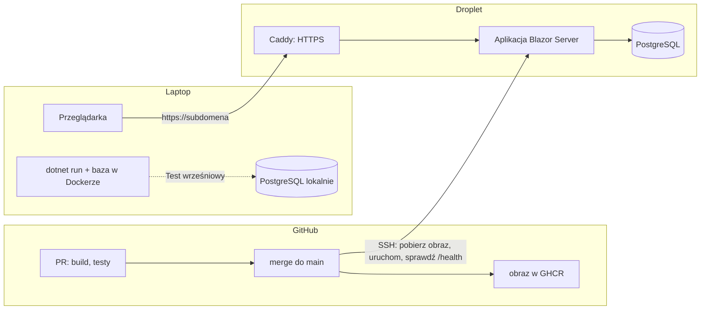

# Jak działa Rejestr czasu pracy i czego się na nim uczysz

Opis dla Autora. Uzupełnia [kręgosłup architektury](architecture-rejestr-czasu.md): tam są reguły dla agentów (AD-1…AD-22), tu wyjaśnienie, co z nich wynika i dlaczego. Wersja z 31.10.2026: aplikacja działa na serwerze, ma Konta i wdraża się sama.

## 1. Obraz całości

Aplikacja działa na Droplecie w DigitalOcean (Frankfurt) pod Twoją subdomeną. Twój laptop służy do pisania kodu przez agentów i do Testu wrześniowego.

**Jak wygląda Sesja wpisywania:** otwierasz adres w przeglądarce, logujesz się, idziesz do Nowego wpisu. Nic nie uruchamiasz.

**Jak zmiana trafia na serwer:**
1. Agent robi zmianę w gałęzi i otwiera PR.
2. GitHub Actions budują aplikację, uruchamiają wszystkie testy i sprawdzają migracje (AD-20, AD-21). Bez zielonego wyniku nie da się zrobić merge.
3. Po merge do `main` potok buduje obraz Dockera, wysyła go do GHCR z tagiem commita, łączy się z Dropletem przez SSH, podmienia obraz i czeka, aż `/health` odpowie.
4. Jeśli coś pójdzie źle, uruchamiasz ręcznie rollback z tagiem poprzedniego obrazu (AD-20).

**Blazor Interactive Server w jednym zdaniu:** komponenty `.razor` wykonują się na serwerze, a przeglądarka trzyma z nim stałe połączenie (SignalR). Każde kliknięcie idzie do serwera, który odsyła tylko zmienione fragmenty strony. Przez internet to nadal działa szybko, bo serwer jest blisko (Frankfurt), ale uśpiony laptop zrywa połączenie, stąd komunikat „Odśwież stronę” (R31).

## 2. Jak pocięty jest kod

Ekran sam pyta EF Core o dane i sam zapisuje (*Transaction Script*). Żeby to się nie rozlało, jest kilka nazwanych wyjątków:

| Katalog | Co tam jest | Dlaczego osobno |
| --- | --- | --- |
| `Features/` | ekrany: Wpisy, Miesiąc, Lista, Zestawienie, Projekty, Typy pracy, Ustawienia konta, Użytkownicy, Pomoc | jedna funkcja = jeden folder |
| `Accounts/` | logowanie, rejestracja, zmiana hasła, bieżący User, operacje Administratora | Konta to osobny świat z własnymi regułami (AD-15–AD-18) |
| `Reporting/` | `MonthReport` — wszystkie sumy i Wiersze zestawienia | **jedno źródło sum** (AD-5) |
| `Domain/` | `Czas`, `PolishCalendar`, `YearMonth` | jedno miejsce formatu `h:mm`, polskich nazw i „dzisiaj” (AD-6) |
| `Data/` | `AppDbContext`, encje, migracje, fabryka kontekstu Usera | jeden właściciel schematu i oddzielenie danych (AD-7, AD-16) |
| `Shared/` | `ReportGrid`, `EntryForm`, `MainLayout`, `PageHeader`, komunikaty | wspólne elementy, których ekrany nie piszą same (AD-9–AD-11) |
| `Startup/` | sprawdzenie bazy, migracje, pierwszy Administrator | kolejność startu (AD-21) |

## 3. Decyzje, które warto zrozumieć

**Jedno źródło sum (AD-5).** Widok miesiąca i Zestawienie muszą mieć identyczne sumy (R10), a budują je różne epiki. Dlatego liczy je tylko `MonthReport.Build`, czysta funkcja bez bazy, testowana w xUnit.

**Kontekst bazy związany z Userem (AD-16).** To najważniejsza nowa decyzja. Ekran nigdy nie pisze `Where(x => x.UserId == ...)`. Dostaje kontekst z fabryki, która już wie, kto jest zalogowany, a filtr w EF Core sam dokłada warunek do każdego zapytania. Dodatkowo baza ma złożone klucze obce `(user_id, project_id)`, więc nawet błąd w kodzie nie zapisze Wpisu z cudzym Projektem. Agent nie może „zapomnieć o filtrze”, bo filtra nie pisze.

**Dwa tryby kontekstu (AD-16).** Identity, start aplikacji i `/health` muszą pracować bez zalogowanego Usera. Dostają tryb systemowy, w którym dane Userów są niewidoczne, a zapis ich danych kończy się wyjątkiem. To przykład, jak reguła „bez wyjątków” musi jednak nazwać swoje wyjątki, żeby dało się ją zbudować.

**Logowanie poza połączeniem Blazora (AD-15).** Ciasteczko logowania można ustawić tylko w zwykłej odpowiedzi HTTP, a połączenie Blazora jej nie daje. Dlatego strony `/konto/...` (logowanie, rejestracja, zmiana hasła, wylogowanie) są statyczne, a reszta interaktywna. Z tego samego powodu zmiana hasła jest tylko na statycznej stronie: zmiana hasła unieważnia ciasteczko, a nowe może wydać tylko odpowiedź HTTP.

**Zablokowanie działa od razu (AD-17).** Trzy warstwy: każde żądanie HTTP sprawdza stan Konta, każda operacja na danych w połączeniu Blazora też, a co minutę sprawdzane są bezczynne karty. Zablokowany User wypada przy pierwszej akcji.

**Krótko żyjący `DbContext` (AD-4).** W Blazor Server komponent żyje tak długo jak połączenie, czyli całą Sesję wpisywania. `DbContext` nie znosi współbieżności i trzyma stare dane, więc nowy kontekst powstaje na każdą operację. To samo dotyczy `UserManager` z Identity: łatwo go wstrzyknąć do komponentu i dostać błąd przy dwóch szybkich kliknięciach.

**Migracje tylko dodające (AD-21).** Po pierwszym wdrożeniu wolno tylko dodawać tabele i kolumny. Dzięki temu rollback to podmiana obrazu: stara wersja aplikacji działa na nowszym schemacie. Pilnuje tego automat w potoku, nie dobra wola agenta.

**Klucze szyfrujące w bazie (AD-19).** ASP.NET szyfruje ciasteczka kluczami Data Protection. W kontenerze giną przy każdym wdrożeniu, co wylogowałoby wszystkich. Trzymamy je w bazie, więc przeżywają wdrożenie i są w kopii Dropletu.

**„Dzisiaj” po polsku (AD-6).** Serwer liczy czas w UTC. Wpis o 0:30 dostałby wczorajszą datę, a to dokładnie błąd z września. Jedyne źródło dzisiejszej daty to `PolishCalendar.Today` w strefie Europe/Warsaw.

**Eksport przez link z `download` (AD-14).** Plik nie może „spłynąć” z komponentu Blazora bez JavaScriptu, więc jest endpoint `GET /zestawienie/{rok}/{miesiac}`. Atrybut `download` jest potrzebny, bo bez niego router Blazora przechwyciłby link i pokazał „nie znaleziono”.

**Zero połączeń wychodzących (AD-12).** Fluent UI przy niektórych polach po cichu ściąga skrypt z unpkg.com. Nagłówek CSP `script-src 'self'` sprawia, że taka regresja od razu wyskakuje w konsoli przeglądarki.

## 4. Czego się uczysz — mapa

| Temat | Gdzie w projekcie |
| --- | --- |
| Blazor Interactive Server, obwód (circuit), strony statyczne obok interaktywnych | każdy ekran; AD-4, AD-15 |
| ASP.NET Core Identity: Konta, role, lockout, security stamp, walidacja ciasteczka | `Accounts/`; AD-15, AD-17 |
| Oddzielenie danych: globalne filtry EF Core, złożone klucze obce | `Data/`; AD-7, AD-16 |
| Fluent UI Blazor 5: DataGrid, Dialog, MessageBar/MessageBox, lokalizacja | `Shared/`; AD-9–AD-11 |
| FluentValidation + Blazilla | walidatory formularzy; AD-8 |
| EF Core 10 + Npgsql: migracje, indeksy funkcyjne, snake_case, `RESTRICT` | `Data/`; AD-7, AD-21 |
| Docker i `docker compose` lokalnie i na serwerze | `docker-compose.yml`, `deploy/`; AD-2, AD-19 |
| Reverse proxy (Caddy), HTTPS z Let's Encrypt, nagłówki forwarded | `deploy/Caddyfile`; AD-19 |
| GitHub Actions: PR, obraz w GHCR, wdrożenie przez SSH, rollback | `.github/workflows/`; AD-20 |
| Bezpieczeństwo serwera: Cloud Firewall, SSH kluczem, sekrety w `.env` i GitHub Secrets | `docs/admin/`; AD-13, AD-19 |
| Minimal API obok Blazora, ClosedXML | endpoint Zestawienia; AD-14 |
| Testy: xUnit, bUnit, Testcontainers, testy oddzielenia danych | `tests/`; Konwencje |
| CSP i kontrola ruchu wychodzącego | AD-12 |

## 5. Zanim agent zacznie budować

- **.NET SDK 10.0.403** — zaktualizuj z 10.0.401 (runtime 10.0.14 ma poprawkę bezpieczeństwa z 25.10.2026, wymaga go Blazilla).
- **Docker Desktop** — zainstalowany; `docker --version` musi działać w terminalu.
- **Domena** — kupiona, z subdomeną gotową do skierowania na Droplet.
- **Konto DigitalOcean i GitHub** — Droplet, firewall i sekrety zakładasz według `docs/admin/`, które powstanie w epiku Konta i wdrożenie.
- Ustaw zmienną użytkownika Windows `DOTNET_CLI_TELEMETRY_OPTOUT=1`.
- Lokalna baza z historii 1.1 zostanie założona od nowa (`docker compose down -v`), bo migracja `Initial` jest przepisywana.
