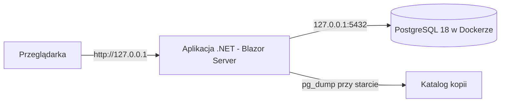

# Jak działa Rejestr czasu pracy i czego się na nim uczysz

Opis dla Autora. Uzupełnia [kręgosłup architektury](architecture-rejestr-czasu.md): tam są reguły dla agentów (AD-1…AD-14), tu wyjaśnienie, co z nich wynika i dlaczego.

## 1. Obraz całości

Wszystko działa na Twoim laptopie i nic nie wychodzi do internetu.

**Jak uruchamiasz (Sesja wpisywania):**
1. Uruchamiasz Docker Desktop, potem `docker compose up -d` (wstaje baza).
2. `dotnet run` (wstaje aplikacja).
3. Aplikacja przy starcie: sprawdza bazę → robi kopię (`pg_dump`) → stosuje migracje → dopiero wtedy przyjmuje Twoje żądania (AD-3).
4. Otwierasz przeglądarkę, wpisujesz notatki z kilku dni, zamykasz.

**Blazor Interactive Server w jednym zdaniu:** komponenty `.razor` wykonują się na serwerze, a przeglądarka trzyma z nim stałe połączenie (SignalR). Każde kliknięcie leci do serwera, serwer odsyła tylko zmienione fragmenty strony. Dla jednego użytkownika na `127.0.0.1` to idealne: zero osobnego API, zero JavaScriptu do pisania.

## 2. Jak pocięty jest kod

Wybrałeś **komponenty prosto na bazie**: ekran sam pyta EF Core o dane i sam zapisuje. To najprostszy wzorzec (w literaturze: *Transaction Script*). Żeby nie rozlał się w chaos, ma kilka nazwanych wyjątków:

| Katalog | Co tam jest | Dlaczego osobno |
| --- | --- | --- |
| `Features/` | ekrany: Wpisy, Miesiąc, Lista, Zestawienie, Projekty, Typy pracy | jedna funkcja = jeden folder |
| `Reporting/` | `MonthReport` — liczy wszystkie sumy i Wiersze zestawienia | **jedno źródło sum** (AD-5) |
| `Domain/` | `Czas`, `PolishCalendar`, `YearMonth` | jedno miejsce formatu `h:mm` i polskich nazw (AD-6) |
| `Data/` | `AppDbContext`, encje, migracje | jeden właściciel schematu (AD-7) |
| `Shared/` | `ReportGrid`, `EntryForm`, komunikaty | wspólne elementy, których ekrany nie piszą same (AD-9–AD-11) |
| `Startup/` | sprawdzenie bazy, kopia, migracje | kolejność startu (AD-3) |

## 3. Pięć decyzji, które warto zrozumieć

**Jedno źródło sum (AD-5).** Widok miesiąca i Zestawienie muszą mieć identyczne sumy (R10). Budują je różne epiki, czyli różne sesje agentów. Gdyby każdy liczył Sumę tygodnia sam, wystarczy, że jeden uwzględni dni z poprzedniego miesiąca, a drugi nie, i Test wrześniowy pada. Dlatego liczy je tylko `MonthReport.Build` — czysta funkcja bez bazy, którą przetestujesz w xUnit danymi z września (zanonimizowanymi).

**Krótko żyjący `DbContext` (AD-4).** W Blazor Server komponent żyje tak długo jak połączenie z przeglądarką — całą Sesję wpisywania. `DbContext` nie jest bezpieczny dla współbieżności i cache'uje encje. Stąd `IDbContextFactory` i nowy kontekst na każdą operację. To jedna z najczęstszych pułapek Blazor Server — warto ją zapamiętać.

**Siatka nie liczy sum (AD-9).** Filtr w kolumnie ukrywa wiersze, ale sumy w nagłówkach Widoku miesiąca zawsze są dla całego Miesiąca, z `MonthReport`. Inaczej po odfiltrowaniu Projektu suma tygodnia na ekranie różniłaby się od tej w xlsx.

**Eksport przez zwykły link (AD-14).** W Blazor Server plik nie może po prostu „spłynąć” z komponentu — potrzebny byłby JavaScript. Zamiast tego endpoint `GET /zestawienie/{rok}/{miesiac}` i zwykły `<a href>`. Ćwiczysz przy okazji Minimal API obok Blazora w jednej aplikacji.

**Zero połączeń wychodzących (AD-12).** Recenzja odkryła, że Fluent UI 5 przy niektórych polach (`FluentNumberInput`, maski) po cichu ściąga skrypt z unpkg.com. Dlatego Czas to zwykłe pole tekstowe `h:mm`, a nagłówek CSP `script-src 'self'` sprawi, że każda taka regresja od razu wyskoczy w konsoli przeglądarki.

## 4. Czego się uczysz — mapa

| Temat | Gdzie w projekcie |
| --- | --- |
| Blazor Interactive Server, cykl życia komponentu, obwód (circuit) | każdy ekran; AD-4 |
| Fluent UI Blazor 5: DataGrid, Dialog, MessageBar/MessageBox, motywy, lokalizacja | `Shared/`, AD-9–AD-11 |
| FluentValidation + Blazilla | walidatory formularzy, AD-8 |
| EF Core 10 + Npgsql: encje, migracje, indeksy funkcyjne, snake_case, `RESTRICT` | `Data/`, AD-7 |
| PostgreSQL w Dockerze, `docker compose`, wolumeny, `pg_dump`/`psql` | `docker-compose.yml`, AD-2, AD-3 |
| Minimal API obok Blazora | endpoint Zestawienia, AD-14 |
| ClosedXML — generowanie xlsx | Zestawienie, AD-14 |
| Testy: xUnit (czysta logika), bUnit (komponenty), Testcontainers (prawdziwa baza) | `tests/`, Konwencje |
| Konfiguracja: `IOptions`, `appsettings.Local.json`, `.env`, prywatność repo | AD-13 |
| CSP i kontrola ruchu wychodzącego | AD-12 |

## 5. Zanim agent zacznie budować

- **.NET SDK 10.0.401** — zainstalowany.
- **Docker Desktop** — zainstalowany, ale polecenie `docker` nie jest widoczne w PATH terminala. Aplikacja wywołuje `docker exec` przy starcie (AD-3), więc `docker --version` musi działać w terminalu, z którego robisz `dotnet run`.
- Ustaw zmienną użytkownika Windows `DOTNET_CLI_TELEMETRY_OPTOUT=1`.
